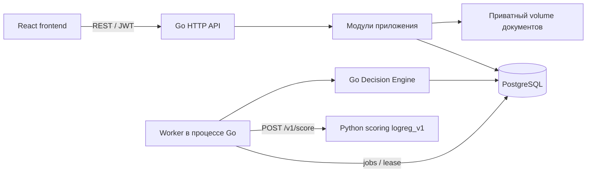

# Архитектура

Go backend — модульный монолит. Он предоставляет все 26 операций OpenAPI v1 и
запускает worker в том же процессе. Redis, Kafka и отдельного сервиса очереди нет.

## Ответственность компонентов

| Компонент | Ответственность |
| --- | --- |
| Frontend | Анкета, документы, отображение статусов, действия пользователя |
| Go | Авторизация, владельцы и роли, заявки, кредитная политика, условия, аудит |
| Python scoring | Балл риска 0–100, факторы и предварительная рекомендация |
| PostgreSQL | Состояние, снимки, очередь, решения, предложения и идемпотентность |
| Файловое хранилище | Двоичное содержимое документов; метаданные находятся в БД |

Python не получает имя, ИНН, документы или кредитный продукт. Go отправляет восемь
полей локального контракта. Высокий score сам по себе не означает одобрение.

## Пакеты Go

| Пакет `internal/` | Назначение |
| --- | --- |
| `config`, `auth` | ENV, OTP, JWT, middleware и текущий пользователь |
| `company`, `credit` | Компания, продукты, точная финансовая математика и рекомендации |
| `application`, `document` | Черновики, версии, история и документы |
| `pipeline` | Submit, предварительные проверки и координация трёх стадий worker |
| `scoring`, `decision` | Внешний HTTP-клиент и окончательная кредитная политика Go |
| `review`, `lending` | Представления результатов и транзакционные действия банка/клиента |
| `httpapi`, `postgres` | HTTP transport и реализация хранения через pgx |

Короткие имена `service.go`, `types.go`, `client.go` остаются: назначение уже видно
из пакета. Массовых переименований Go-кода и новых слоёв не требуется.

## Хранение и надёжность

Используются существующие таблицы `companies`, `users`, `otp_challenges`,
`credit_products`, `applications`, `documents`, `jobs`, `credit_decisions`, `offers`,
`application_events`, `idempotency_keys`. Миграции запускаются до backend.

Submit атомарно фиксирует анкету, компанию, условия продукта, событие и job.
Снимки защищены от изменения триггером PostgreSQL. Worker захватывает задания
через `FOR UPDATE SKIP LOCKED`, использует lease-токен и ограниченные повторы.
Порядок стадий: prechecks → scoring → decision. Внешний HTTP идёт вне транзакции.
Сохранённый успешный scoring не вызывается повторно после перезапуска.

Итоговое решение, предложение, статус и событие фиксируются одной транзакцией.
Lease проверяется до и после записи. Ручные решения и accept/decline блокируют
заявку; результат идемпотентности входит в ту же транзакцию. История упорядочена
по sequence. Системные события имеют actorId=null, пользовательские — UUID из JWT.

## Документы и доступ

CLIENT читает только свои заявки своей компании. BANK_EMPLOYEE не видит draft
даже по UUID или через документы. После submit сотрудник читает историческую
карточку из снимков, а не текущие сведения компании.

Файлы PDF/PNG/JPEG хранятся под серверными ключами в отдельном volume. Проверяются
тип, содержимое, размер, SHA-256 и имя. API не раскрывает storage keys. Состояния
pending/ready/failed и восстановление загрузок защищают от частичных записей.
Поддерживается один процесс backend на файловый volume; несколько worker
горутины внутри этого процесса безопасны.

[Кредитная политика](credit-process.md) · [Состояния API](../api/FRONTEND_INTEGRATION.md).
