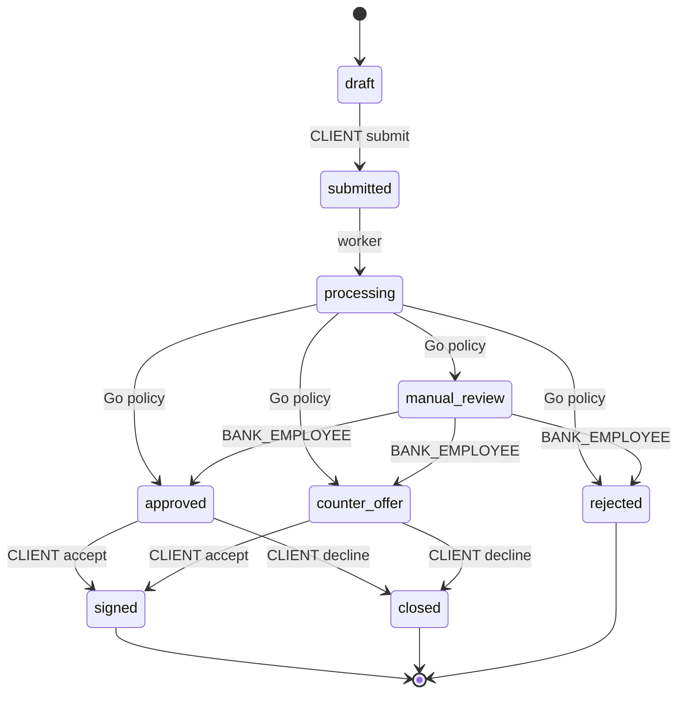

# Кредитный процесс

## Продукты и рекомендации

Каталог содержит синтетические `turnover` и `investment`. Точные суммы, сроки,
ставки и цели возвращает GET credit-products. Условия не являются предложениями
Альфа-Банка. До подачи заявки POST recommendations подбирает продукт и объясняет
ограничения, не создавая заявку и не вызывая Python.

| Продукт | Цели | Сумма, ₽ | Срок, месяцы | Ставка | Возраст бизнеса |
| --- | --- | --- | --- | --- | --- |
| turnover | Запасы, текущие расходы, сезонные закупки | 100000–3000000 | 6–24 | 22% | от 6 месяцев |
| investment | Оборудование, модернизация | 300000–10000000 | 12–60 | 20% | от 12 месяцев |

Это начальные демонстрационные условия. Для конкретной заявки действует снимок
выбранного продукта, для новой анкеты — текущий ответ каталога.

## Жизненный цикл



| Статус | Значение |
| --- | --- |
| draft | Редактируемый частный черновик; возможны несколько одного продукта |
| submitted | Проверен submit, зафиксированы снимки и создано задание |
| processing | Фоновая обработка, включая ожидание и технические повторы |
| manual_review | Нужен сотрудник; окончательного решения ещё нет |
| approved | Одобрена исходная сумма и срок |
| counter_offer | Доступно альтернативное предложение |
| rejected | Кредитный отказ |
| signed | Предприниматель демонстрационно подтвердил условия |
| closed | Предприниматель отклонил предложение |

Техническая ошибка сохраняется отдельно от кредитного исхода. Поле processing
в decision/assessment показывает prechecks/scoring/decision и
waiting/running/retrying/failed. Ручного API перезапуска jobs нет.

## От черновика до scoring

Черновик допускает неполные поля. Submit проверяет обязательные сведения,
границы продукта, возраст компании и документы. Для инвестиционной заявки нужен
EQUIPMENT_INVOICE; BANK_STATEMENT зависит от серверного доверенного источника
финансов. Предварительные проверки компании и БКИ синтетические и сохраняются.

Worker отправляет Python снимок финансов и числовые результаты БКИ. Ответ
сохраняется в jobs.scoring_response. Python использует модель logreg_v1 для score
и отдельные правила рекомендации; Go не воспроизводит модель или её коэффициенты.

## Кредитная политика Go

Версия текущей политики — `go-demo-v2`. Пороги риска сохранены: LOW ≥80,
MEDIUM 50–79, HIGH <50. Сохранённые результаты go-demo-v1 читаются без переоценки.
Технически неполные или повреждённые данные никогда не превращаются в отказ.

Приоритеты:

1. Проверка целостности снимков, запроса и сохранённого ответа.
2. Отказ при HIGH, критических регистрационных нарушениях, недостаточном возрасте,
   неподдерживаемой цели или нарушении границ продукта.
3. Обязательные финансовые ограничения: положительный операционный поток,
   маржа не ниже 10%, менее трёх просрочек, долг ниже 150% годовой выручки.
4. Для LOW невозможность обслуживать даже минимум продукта — финансовый отказ,
   включая конфликт с рекомендацией Python.
5. MEDIUM, неоднозначные проверки и остальные противоречия — manual_review.
6. LOW с допустимым платежом и согласованной рекомендацией — approved;
   с чрезмерной нагрузкой и доступной меньшей суммой — counter_offer.

Обязательные финансовые ограничения проверяются по снимку и БКИ, а не по
округлённым model factors или русскому тексту reasons. Они действуют и при ручном
одобрении. Это кредитные ограничения, а не копия ML-модели. Python rejected при
другом финансовом пороге не копируется автоматически: Go либо применяет своё
строгое основание отказа, либо сохраняет конфликт для сотрудника.

## Условия предложения

```text
surplus = monthlyRevenueRub − monthlyExpensesRub
budget = max(0, floor(max(0, surplus) / 2) − existingMonthlyPaymentsRub)
```

Применяется одна общая аннуитетная математика internal/credit. Ставка определяется
снимком продукта, платёж округляется вверх до рубля, доступная сумма — вниз.
Для автоматической альтернативы берётся минимум доступной суммы, исходного
запроса и рекомендации Python. Проверяются минимум продукта и конечный платёж;
срок и ставка сохраняются. Стресс-ставка 20% из scoring не заменяет ставку продукта.

## Ручные решения и подтверждение

Сотрудник работает только с manual_review. Approved сохраняет исходные условия,
counter_offer меняет сумму/срок в границах снимка, rejected не создаёт предложения.
Внутренний комментарий доступен только банку; клиент получает отдельные reasons.

Accept и decline доступны только владельцу текущего active offer. Они сохраняют
исходное decision, меняя состояние заявки и предложения. UUID Idempotency-Key
обязателен для обоих действий и ручного решения; хранение — 24 часа. Проверка
прав идёт до replay, replay — до устаревшей version. После истечения ключа аудит
не позволяет повторить действие или выполнить противоположное.

`signed` не означает выдачу денег, электронную подпись или юридический договор.
