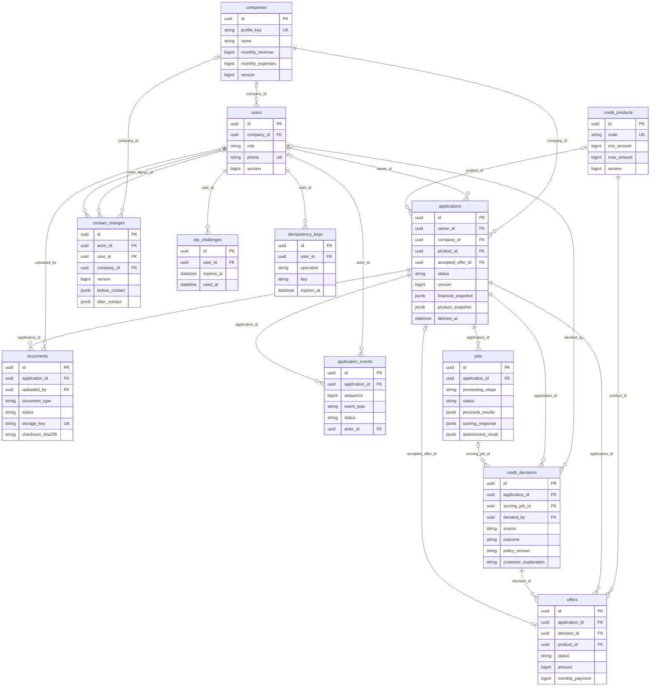

# Модель данных

Схема соответствует миграциям `migrations/000001`–`000012`. PostgreSQL хранит
состояние заявок, снимки входных данных, задания обработки, решения и аудит.
Содержимое загруженных документов лежит в приватном Docker volume; таблица
`documents` хранит только метаданные и серверный ключ файла.

## Важные ограничения

- `applications(owner_id, company_id)` ссылается на пару `users(id, company_id)`:
  владелец заявки принадлежит той же компании. Сотрудник банка читает только
  отправленные заявки через проверку роли в API.
- `users.company_id`, `application_events.actor_id` и
  `credit_decisions.decided_by` могут быть пустыми: сотрудник банка не привязан к
  компании клиента, системное событие не имеет автора, автоматическое решение
  не имеет сотрудника. `credit_decisions.scoring_job_id` также необязателен; схема
  БД не ограничивает число версий решений на одно задание.
- При отправке заявки `financial_snapshot` и `product_snapshot` фиксируют
  исторические данные. Последующее изменение компании или продукта не переписывает
  уже отправленную заявку.
- `jobs` хранит стадии prechecks → scoring → decision, попытки и сохранённые ответы.
  `credit_decisions` содержит итог Go; `offers` существует для одобрения или
  альтернативных условий. Рекомендация Python в `jobs.scoring_response` не равна
  кредитному решению.
- `application_events` упорядочены уникальной парой `(application_id, sequence)`.
  `contact_changes` ведёт отдельный аудит контактов и не входит в клиентскую
  кредитную историю.
- `applications.accepted_offer_id` и `offers.decision_id` используют составные
  внешние ключи с `application_id`, чтобы связывать записи одной заявки.
  `idempotency_keys` защищает повторное выполнение ручного решения и ответа клиента.
- Удаление draft мягкое: `deleted_at` скрывает его из активного списка. Данные
  отправленных заявок, документов и событий сохраняются для демонстрационного
  аудита. Реальное хранение персональных данных и банковские операции здесь не
  реализованы.

[Диаграмма состояний](credit-process.md) · [Архитектура](architecture.md) ·
[SQL-миграции](../migrations/).
